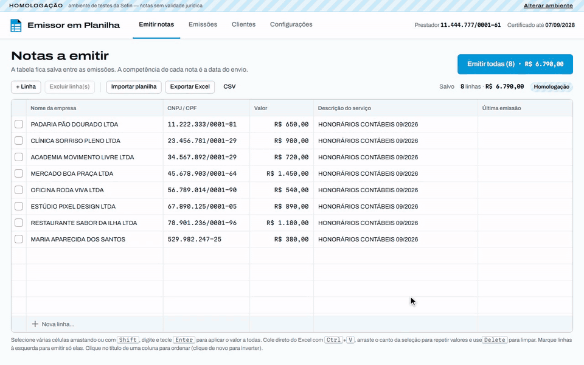

  

<h1 align="center">Emissor em Planilha</h1>

  Emita dezenas de <strong>NFS-e do Padrão Nacional</strong> de uma vez, a partir de uma tabela que funciona como o Excel.

  

---

> [!TIP]
> ### Não quer instalar nada? Use em **[emissoremplanilha.com](https://emissoremplanilha.com)**
>
> O Emissor em Planilha pronto para usar, só com o navegador, por **R$ 59,90/mês**.
>
> - Endereço próprio para a sua empresa (`suaempresa.emissoremplanilha.com`), separado dos outros clientes.
> - Sem servidor, sem instalação, sem atualizar nada: a gente cuida disso.
> - Acesse do escritório ou de casa, com login e verificação em duas etapas.
>
> **[Assinar em emissoremplanilha.com →](https://emissoremplanilha.com)**

## O que ele faz

- **Tabela tipo Excel** com cliente, CNPJ/CPF, valor e descrição. Cole do Excel, edite várias células de uma vez e
  a tabela fica salva para o mês seguinte.
- **Emissão em lote** direto na Sefin Nacional com o certificado A1, sem risco de nota em duplicidade.
- **Erros explicados**: código da Sefin, linha afetada e como corrigir.
- **XML e DANFSe em PDF** de cada nota, individual ou em ZIP. Cancelamento pelo próprio sistema.

## Rodar por conta própria

O programa é livre e gratuito. No computador que vai servir o sistema:

- **Windows:** instale o [uv](https://docs.astral.sh/uv/getting-started/installation/) e o
  [Node.js](https://nodejs.org/) LTS, baixe o projeto e dê dois cliques em **`iniciar.bat`**.
- **Docker:** na pasta do projeto, `docker compose up -d`.

Depois abra `http://<nome-do-computador>:8000` no navegador e siga a configuração inicial (certificado digital e,
se tiver, XMLs de notas já emitidas). Comece em **Homologação** antes de emitir notas de verdade.

Instalação detalhada, uso, configuração, segurança e desenvolvimento: **[guia completo](docs/guia.md)**.

## Aviso

Projeto independente, **sem vínculo** com a Receita Federal, o Comitê Gestor da NFS-e ou a Sefin Nacional. Notas
emitidas em Produção têm validade jurídica: teste em homologação e confira os padrões fiscais com o seu contador.

<!-- LICENÇA: escolher (ex.: MIT) e adicionar o arquivo LICENSE na raiz. -->
