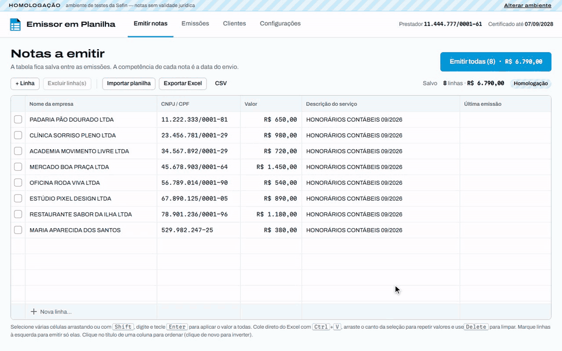

  

<h1 align="center">Emissor em Planilha</h1>

  Emissor de <strong>NFS-e Nacional</strong> gratuito e de código aberto: emita dezenas de notas de serviço de uma vez,
  a partir de uma planilha que funciona como o Excel.

  
  
  
  

  

---

> [!TIP]
> ### Não quer instalar nada? Use em **[emissoremplanilha.com](https://emissoremplanilha.com)**
>
> O Emissor em Planilha pronto para usar, só com o navegador, por **R$ 59,90/mês**.
>
> - Endereço próprio para a sua empresa (`suaempresa.emissoremplanilha.com`), separado dos outros clientes.
> - Sem servidor, sem instalação, sem atualizar nada: a gente cuida disso.
> - Acesse do escritório ou de casa, com login e verificação em duas etapas.
>
> **[Assinar em emissoremplanilha.com →](https://emissoremplanilha.com)**

## Para quem é

Para quem emite muitas notas de serviço todo mês (escritórios de contabilidade, consultorias, escolas, prestadores com
carteira fixa de clientes) e cansou de preencher uma por uma no Emissor Nacional do gov.br. É uma **alternativa
gratuita** para a emissão em lote: o programa é **open source** (código aberto), grátis para instalar e usar no seu
computador ou servidor, e emite pela API oficial da Sefin Nacional com o seu certificado digital A1. Se preferir não
instalar nada, existe a versão hospedada, paga (veja acima).

## O que ele faz

- **Tabela tipo Excel** com cliente, CNPJ/CPF, valor e descrição. Cole do Excel, edite várias células de uma vez e
  a tabela fica salva para o mês seguinte.
- **Emissão em lote** direto na Sefin Nacional com o certificado A1, sem risco de nota em duplicidade.
- **Erros explicados**: código da Sefin, linha afetada e como corrigir.
- **XML e DANFSe em PDF** de cada nota, individual ou em ZIP. Cancelamento pelo próprio sistema.

## Rodar por conta própria

O programa é livre, gratuito e de código aberto: não tem mensalidade nem limite de notas. No computador que vai servir o sistema:

- **Windows:** instale o [uv](https://docs.astral.sh/uv/getting-started/installation/) e o
  [Node.js](https://nodejs.org/) LTS, baixe o projeto e dê dois cliques em **`iniciar.bat`**.
- **Docker:** na pasta do projeto, `docker compose up -d`.

Depois abra `http://<nome-do-computador>:8000` no navegador e siga a configuração inicial (certificado digital e,
se tiver, XMLs de notas já emitidas). Comece em **Homologação** antes de emitir notas de verdade.

Instalação detalhada, uso, configuração, segurança e desenvolvimento: **[guia completo](docs/guia.md)**.

## Problemas e sugestões

Encontrou um erro ou tem uma ideia? [Abra um relato](https://github.com/iurijw/emissor-em-planilha/issues/new/choose).
O relato é público: não inclua dados reais de clientes, senhas nem o certificado.

Quer contribuir? Veja [como contribuir](CONTRIBUTING.md). Falhas de segurança vão por e-mail, conforme
[SECURITY.md](SECURITY.md).

## Aviso

Projeto independente, **sem vínculo** com a Receita Federal, o Comitê Gestor da NFS-e ou a Sefin Nacional. Notas
emitidas em Produção têm validade jurídica: teste em homologação e confira os padrões fiscais com o seu contador.

## Licença

Software livre sob a [GNU AGPL-3.0](LICENSE): você pode usar, estudar, modificar e redistribuir à vontade, sem
garantia. Quem oferecer uma versão modificada para outras pessoas usarem pela rede precisa disponibilizar o código
dessa versão sob a mesma licença.
